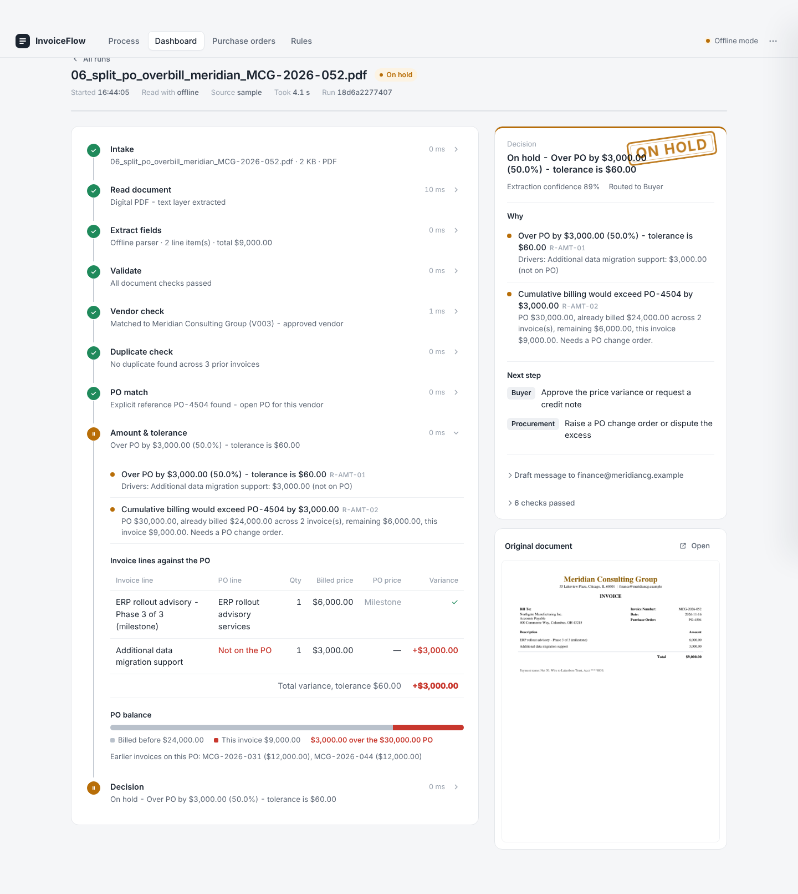
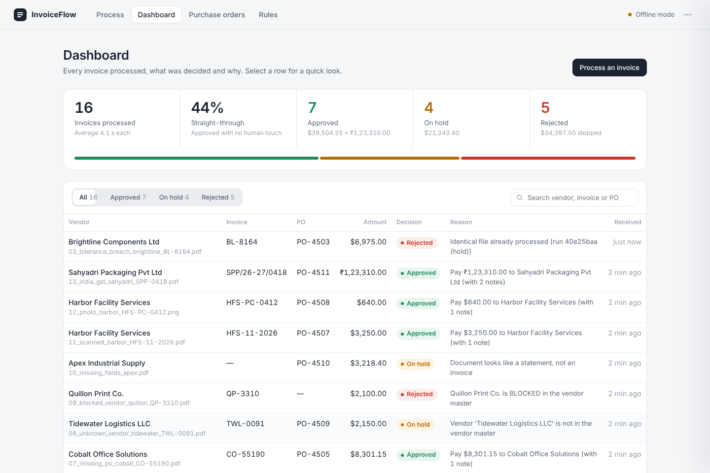
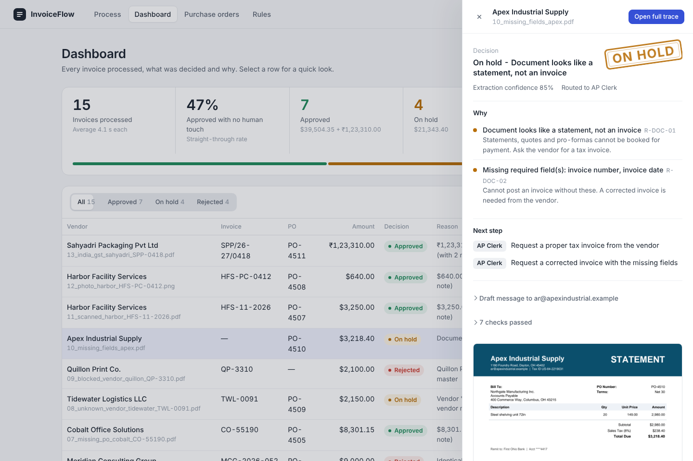
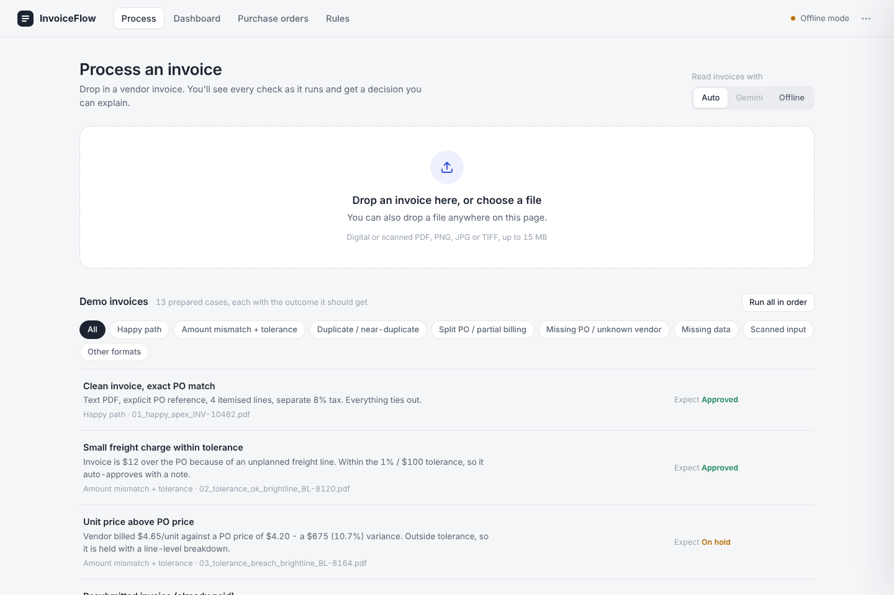

# InvoiceFlow — invoice PDF → reasoned AP decision

Case study PS-1 (Finance / AP). InvoiceFlow takes a vendor invoice (digital PDF, scanned PDF or phone photo) and returns **Approve / Hold / Reject**, with every step visible and every decision explained. You can watch each stage run live, and a dashboard keeps the history of all runs.

> **Design principle: the AI reads, the rules decide.**
> Gemini (or the offline parser) only *extracts* what is printed on the invoice. Every decision comes from plain, deterministic rules, each with an ID (R-AMT-01 …), so a decision can be explained, repeated and audited. The same input always gets the same decision, and you can trace each one back to the rule that caused it.

---

## 1. Process map

```mermaid
flowchart LR
  A[Invoice in<br/>PDF · scan · photo] --> B[1 Intake<br/>hash, type]
  B --> C{2 Text layer?}
  C -- yes --> D[pdfplumber text]
  C -- no --> E[OCR: 3 Tesseract passes<br/>keep the one whose maths reconciles]
  D & E --> F[3 Extract fields<br/>Gemini multimodal → JSON<br/>or offline parser]
  F --> G[4 Validate<br/>required fields · arithmetic · dates · confidence<br/>AI vs parser cross-check]
  G --> H[5 Vendor master<br/>unknown → HOLD · blocked → REJECT]
  H --> I[6 Duplicate check<br/>normalised number · file hash · same amount/date]
  I -- hard reject --> Z
  I --> J{7 PO reference?}
  J -- explicit --> K[exists? same vendor? open?]
  J -- missing --> L[Infer: score vendor's open POs<br/>line coverage + amount fit]
  K & L --> M[8 Amount & tolerance<br/>line-level 2-way match · price variance<br/>cumulative PO balance · qty · tax]
  M --> Z[9 Decision<br/>APPROVE / HOLD / REJECT<br/>reasons · owner queue · drafted email]
  Z -- approve --> P[(PO ledger<br/>balance drawn down)]
```



**Decision logic:** any `reject` finding → **REJECT**. Otherwise any `hold` finding → **HOLD**, routed to the queue that owns the problem (AP clerk, Buyer, Procurement, Vendor Master, Compliance). Otherwise → **APPROVE**, with any `note`s logged alongside the approval. Hard rejects (blocked vendor, exact duplicate) skip the PO stages, because nothing after them could change the outcome.

## 2. Edge cases (and why these four)

| # | Edge case | Demo file(s) | What the process does |
|---|---|---|---|
| 1 | **Split PO / partial billing** | `05`, `06` | Each approval is posted to a PO ledger. Milestone 2 ($12k) fits the $18k remaining → approve, leaving $6k. The final invoice ($9k, including an out-of-scope line) would put the PO $3k over → **HOLD** for a change order. A PO-balance bar shows billed before / this invoice / overrun. |
| 2 | **Duplicate / near-duplicate** | `04`, or re-run `01` | Invoice numbers are normalised (`INV-0010482` = `inv 10482`, `BL7781` = `BL-7781`) and compared against both run history and ERP history. An exact match → **REJECT**, and a "payment reminder" re-send is caught even with a different date format. Same vendor + same amount within 10 days, or an invoice number one character off → **HOLD** as a possible duplicate. An identical file hash → **REJECT**. |
| 3 | **Amount mismatch + tolerance** | `02`, `03` | Each invoice line is matched to a PO line, giving a price variance per line plus any charges that aren't on the PO. Tolerance is the *lesser* of 1% and $100. A $12 freight line → **APPROVE with a note**. A $4.20→$4.65 unit-price increase ($675, 10.7%) → **HOLD** to the Buyer, with a drafted vendor email listing what's driving the variance. |
| 4 | **Missing PO / unknown vendor** | `07`, `08`, `09` | No PO number: the process scores the vendor's open POs (how many lines match + how well the amount fits) and infers the PO only if it is clearly the best match (score ≥ 0.80 *and* at least 0.20 ahead of the runner-up). Otherwise → HOLD. Unknown vendor → **HOLD**, routed to vendor onboarding. Blocked vendor → **REJECT** and escalated to compliance. |

Extra cases covered: scanned image-only PDF (`11`), phone photo PNG (`12`), an Indian GST tax invoice (`13`: INR, HSN column, CGST+SGST, lakh grouping, DD/MM date), statement with no invoice number or date (`10`), unreadable or corrupt files (→ HOLD for manual keying), and the AI and the parser disagreeing on a digital PDF's total (→ HOLD).

Run the library in order (the **Run all 13 in order** button) and you get 7 approved, 4 held and 2 rejected. Each card says what it expects.

The **Purchase orders** view can filter settled and unsettled POs. Expand a PO to mark each invoice paid or unpaid; a PO is settled only when it has invoices and all of them are marked paid. The prepared paid invoices start as settled, and **Reset demo data** restores those sample payment statuses. Payment changes are shared with other visitors; do not use this unauthenticated deployment to track real payments.

## 3. Run it locally

```bash
# Python 3.11+ ; Tesseract is optional but enables offline OCR for scans
#   macOS: brew install tesseract     Ubuntu: sudo apt install tesseract-ocr
pip install -r requirements.txt
cp .env.example .env          # add GEMINI_API_KEY to enable AI extraction (optional)
./run.sh                      # → http://localhost:8000
```

Free Gemini key: <https://aistudio.google.com/apikey>. Without a key, everything runs offline using the rule-based parser plus Tesseract.

Tests (all 13 demo decisions, rerun → duplicate, corrupt file, unsupported type, GST parsing, Gemini rate-limit handling):

```bash
STAGE_DELAY_S=0 python -m pytest -q
```

Regenerate the sample invoices: `python scripts/make_samples.py`.

### Gemini free-tier rate limits
The free tier allows roughly 10 requests per minute per Google project, and that limit is shared by **all** models. InvoiceFlow handles this as follows:
- **Pacing:** calls are spaced to `GEMINI_RPM` (default 8/min), so a 13-invoice batch stays under the limit.
- **Per-minute 429:** it waits the `retryDelay` Gemini returns (up to `GEMINI_MAX_WAIT_S`, default 35 s) and retries the **same** model once. Switching models would hit the same project-wide limit.
- **Daily 429:** daily quotas are per model, so it moves to the next model in `GEMINI_FALLBACK_MODELS`.
- **Still limited:** Gemini is paused for `GEMINI_COOLDOWN_S` (60 s) and invoices use the offline parser in the meantime. The live view logs every wait and fallback.
- **Bad API key:** fails immediately with "API key rejected" instead of retrying.

If you see per-minute 429s on your very first call, check the project's quota page in Google AI Studio. Some new projects start with a very low regional limit.

## 4. Deploy

### Vercel

The Vercel deployment uses the root Dockerfile (including Tesseract), Neon Postgres for shared run history and the PO ledger, a private Vercel Blob store for invoice files, and one Vercel Daemon to process runs in order. The worker daemon runs only in production deployments.

Vercel defaults to `DEMO_MODE=true`: the prepared sample invoices remain available, while arbitrary uploads are disabled. The current public deployment sets `DEMO_MODE=false`, which hides the sample invoice library and enables uploads up to 15 MB. Because there is no login, anyone can upload invoices; use access protection before accepting sensitive documents.

1. Install the Vercel CLI and link this folder to a Vercel project:

   ```bash
   npm install -g vercel
   vercel link
   ```

2. Connect a Neon Postgres database to the project from the Vercel Marketplace. Make sure the project has `DATABASE_URL` (or `POSTGRES_URL`) in its environment.
3. Create and connect a **private** Blob store:

   ```bash
   vercel blob create-store invoices --access private --yes
   ```

4. Add `GEMINI_API_KEY` in the Vercel project’s Environment Variables settings. Add any optional rule overrides there as needed.
5. Deploy to production:

   ```bash
   vercel --prod
   ```

Vercel does not read the local `.env` file. Configure secrets in the Vercel project settings; never commit them. The connected Blob store supplies its runtime credentials. The first production start creates the database tables and seeds the PO ledger.

### Render

For the original single-container deployment, push this folder to a GitHub repo and create a Render Blueprint from `render.yaml`; set `GEMINI_API_KEY` in the dashboard. The Dockerfile installs Tesseract. Railway and Fly.io can use the same Dockerfile.

On local SQLite deployments, history lives in `storage/`; use **Reset demo data** before a demo if you want a clean ledger.

## 5. How it's built

| Layer | Choice | Why |
|---|---|---|
| API | FastAPI + ordered local thread / Vercel daemon | Invoices are processed strictly in arrival order. That matters for split billing, because each approval changes the PO balance. |
| Live view | Server-Sent Events from an `events` table | Each stage writes start/log/end events. The UI replays them, so reopening a past run shows the same trace. |
| Store | SQLite locally; Neon Postgres + private Vercel Blob on Vercel | Runs serve as the audit trail. The ledger holds PO consumption, seeded with ERP history; uploaded files stay in private object storage. |
| Text | pdfplumber → Tesseract (3 passes) | Scanned documents get three OCR passes (with and without despeckle, two page layouts). The parse whose subtotal, tax and total reconcile is kept. This fixed a real `$640.00 → 6490.00` misread. |
| Extraction | Gemini `generateContent` with the original file inline (PDF or image), JSON output, per-field confidence | One multimodal call handles digital PDFs, scans and photos alike. If Gemini errors or hits a rate limit, it tries fallback models, then the offline parser, and logs that in the trace. |
| Cross-check | On digital PDFs, Gemini's output is compared with the local parser | Two independent reads have to agree. If they disagree on the total, the invoice is held instead of trusting the model. |
| Rules | `app/rules.py`, thresholds in env vars | Rules are deterministic and testable, and the Rules page lists them all. |
| Master data | `data/*.csv` (vendors, POs, PO lines, ERP history) | Stands in for the procurement spreadsheet / ERP. |
| UI | Vanilla JS + CSS, no build step | Pages: Process (drop a file anywhere, demo library with filters), live run (expandable steps, decision stamp, zoomable document), Dashboard (animated stats, filters, search, quick-look side panel), Purchase orders (expandable rows), Rules. Respects reduced-motion settings. |

### Key files
```
app/pipeline.py    stage orchestration + live events
app/extract.py     text layer, OCR passes, offline parser, Gemini client
app/rules.py       every business rule, decision composer, drafted messages
app/masterdata.py  vendor/PO loading, fuzzy vendor match, PO balances
app/main.py        REST + SSE endpoints, static UI
static/            index.html, app.js, styles.css
data/              vendors.csv, purchase_orders.csv, po_lines.csv, seed_ledger.csv
samples/           13 demo invoices + catalog.json
```

### API
`POST /api/runs` (multipart `file` or `sample`, `engine=auto|gemini|offline`) · `GET /api/runs/{id}/stream` (SSE) · `GET /api/runs/{id}` · `GET /api/runs` · `GET /api/stats` · `GET /api/pos` · `POST /api/batch` · `POST /api/reset`

## 6. Known limits and what I'd build next
- **3-way match:** add goods-receipt data so billed quantity is checked against quantity actually received.
- **Email intake:** an IMAP/Gmail watcher feeding the same `POST /api/runs`.
- **Human-in-the-loop actions:** approve/override buttons on held invoices that write back with a reason code, and use overrides to tune tolerances.
- **Multi-page, multi-invoice PDFs:** split the PDF into separate invoices before extraction.
- **Vendor bank-detail change detection:** compare the remittance details printed on the invoice against the vendor master (a common fraud pattern; the samples already include "new bank details" text).
- Swap SQLite for Postgres and the single worker for a queue when volume calls for it.

## Screenshots
| | |
|---|---|
|  |  |
|  |  |
